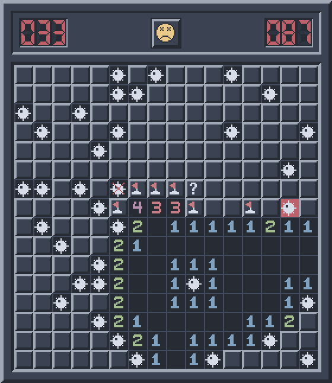
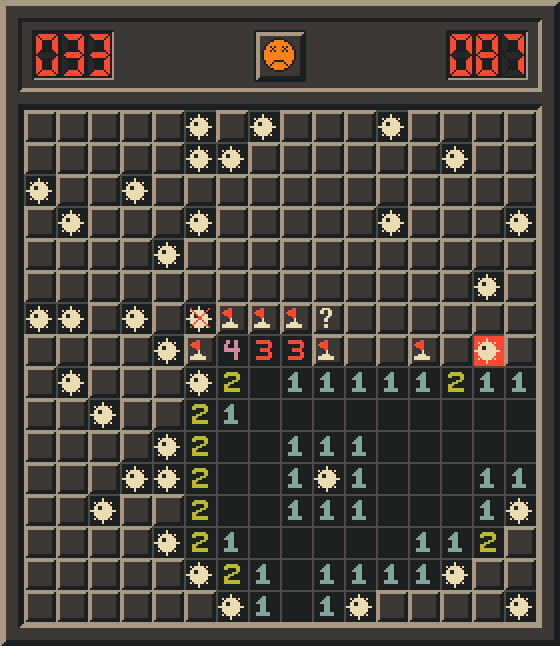

# swaysweeper

The classic Windows Minesweeper — Windows 95–2000 `winmine`, rules and all —
drawn in the colours of the active dotfiles palette, and recoloured live when
the palette switches. Inspired by [omasweeper](https://github.com/jankeesvw/omasweeper).

- Beginner, Intermediate, Expert and Custom; Marks (?), Color, Best Times.
- winmine's rules: the first-click mine moves to the top-left-most free square
  (never the last row or column); right *press* flags; chord with both buttons,
  the middle button or Shift+left, on the first button released.
- One deliberate deviation: the 95/98 one-click-win timer bug is fixed, as 2000 did.
- Extras that stay out of the way: vim/arrow keyboard play (`?` lists the keys),
  Zoom ×2 when it fits, and a game in progress survives closing — or a crash.

The same lost board under the built-in Windows 95 colours and the two dotfiles
palettes — drawn from the palette rather than pinned, which is the point:

| Windows 95 | nord | gruvbox |
| --- | --- | --- |
|  |  |  |

## Play

| Mouse | |
| --- | --- |
| Left click | open a square |
| Right click | flag, then `?`, then clear (on the press, as winmine) |
| Both buttons, middle, or Shift+left | open around a satisfied number |
| Smiley | new game |

| Keyboard | |
| --- | --- |
| Arrows or `h j k l` | move the cursor (the first press puts it in the middle) |
| Space or Enter | open — or, on a number, open around it |
| `f` | flag, then `?`, then clear |
| `c` | open around a number |
| F2 | new game |
| `?` | list the keys |
| Ctrl+Q | exit |

## Install

    make install      # ~/.local/{bin,share}; a desktop entry with an absolute Exec=
    make test

Needs `gtk4`, `python-gobject`, `python-cairo`; `pipewire` (`pw-play`) for sound.

## Colours

The game reads `~/.config/swaysweeper/colors.gen.toml` — a flat table of
`slot = "#rrggbb"` — and watches it. In this setup the dotfiles repo's `theme`
renders it from `palettes.toml`. With no file it is Windows 95 grey.

    swaysweeper --check-colors FILE   # unknown/missing/invalid slots, contrast floors

The slots and floors are in `docs/specs/2026-10-09-swaysweeper-design.md` §3.

## Screenshots

    tools/screenshots.py nord=nord.toml gruvbox=gruvbox.toml

renders `screenshots/*.png` offscreen from theme files (no window opens).

## State

`$XDG_STATE_HOME/swaysweeper/` — settings, best times and the game in progress.
A file that will not parse is moved aside to `*.bad`; the game always starts.
